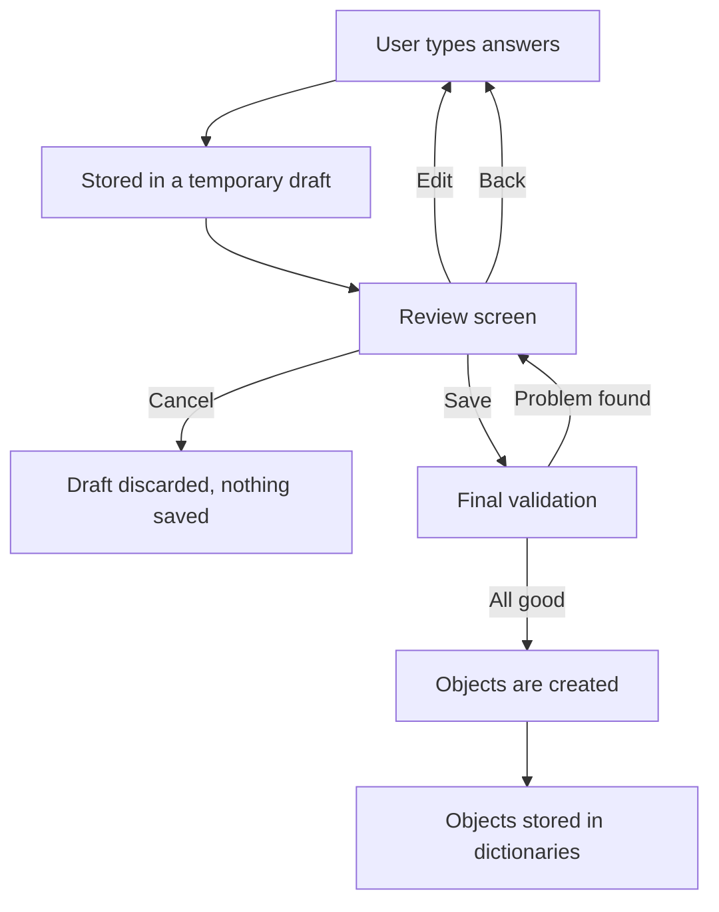
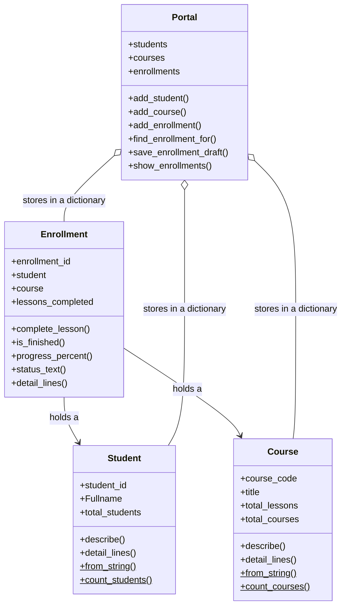

# Student Learning Portal


> A beginner-friendly Python console application that uses **Object-Oriented Programming** to track learners, courses and lesson progress, built as an open, privacy-respecting educational tool.

---

##  Table of Contents

1. [Overview](#-overview)
2. [The Real-World Problem](#-the-real-world-problem)
3. [Features](#-features)
4. [Demo](#-demo)
5. [How It Works](#-how-it-works)
6. [OOP Concepts Used](#-oop-concepts-used)
7. [Instance Method vs Class Method](#-instance-method-vs-class-method)
8. [Data Structure](#-data-structure)
9. [Digital Public Goods Alignment](#-digital-public-goods-dpg-alignment)
10. [Sustainable Development Goals (SDG) Alignment](#-sustainable-development-goals-sdg-alignment)
11. [Privacy](#-privacy)
12. [Getting Started](#-getting-started)
13. [Testing](#-testing)
14. [Project Structure](#-project-structure)
15. [Limitations and Roadmap](#-limitations-and-roadmap)
16. [Contributing](#-contributing)
17. [Author](#-author)

---

##  Overview

The **Student Learning Portal** manages three kinds of records: **learners**, **courses** and **enrollments** (a link between a learner and a course). Users can enroll learners, record completed lessons, search records, see progress as a percentage and view statistics, all from a clean, numbered text menu.

The project is deliberately small and readable. It uses only the Python standard library, so anyone can run it, read it and learn from it.

##  The Real-World Problem

Small schools, training centres and community learning programmes often track learners on paper or in scattered spreadsheets. This leads to common problems:

- It is hard to see **who is enrolled in which course**.
- **Progress** is not recorded consistently.
- The same learner gets entered **twice**, with slightly different details.
- Half-finished or incorrect records are saved by mistake.

This portal shows a simple, safe way to manage that information: one record per learner, one per course, and one enrollment linking them, with checks that stop duplicates and incomplete records.

**Target users:** teachers and tutors, programme coordinators, and beginner programmers who want a realistic OOP example.

##  Features

| Feature | Description |
|---|---|
|  View enrollments | Every record is shown in a clear **vertical** layout |
|  Enroll a student | Guided form with step-by-step questions |
|  Complete a lesson | Updates the lesson count, progress % and status |
|  Search | By enrollment ID (partial), student ID or course code, **case-insensitive** |
|  Filter | View completed courses or courses in progress |
|  Statistics | Totals, finished vs in-progress, average progress |
|  Remove | Delete an enrollment after a Yes/No confirmation |
|  Duplicate protection | Duplicate IDs and repeat enrollments are refused |
|  Object reuse | An existing student or course is reused, never copied |
|  Back /  Edit /  Cancel /  Save | Never get trapped in a form |
|  Input validation | No crashes on empty input, letters, zero, negatives or unknown IDs |

##  Demo

**Main menu**

```text
========================================
        STUDENT LEARNING PORTAL
========================================

1. View all enrollments
2. Enroll student
3. Complete lesson
4. View enrollment details
5. Search by enrollment ID
6. Search by student ID
7. Search by course code
8. View completed courses
9. View courses in progress
10. Show statistics
11. Remove enrollment
0. Exit

========================================
Choose an option:
```

**An enrollment (vertical output)**

```text
========================================
               ENROLLMENT
========================================

Enrollment ID : E001

Student ID    : S001
Student       : Ama

Course Code   : PY101
Course Title  : Intro to Python

Lessons       : 2 / 5
Progress      : 40%
Status        : In Progress

========================================
```

**Statistics**

```text
========================================
           PORTAL STATISTICS
========================================

Students         : 4
Courses          : 3
Enrollments      : 4

Finished         : 2
In Progress      : 2

Average Progress : 65%

Created in this run (class methods):
Student objects  : 4
Course objects   : 3

========================================
```

**Duplicate protection**

```text
========================================
            CANNOT SAVE YET
========================================

Please fix this first:

This student is already enrolled in this course.
Edit the Student ID or the Course Code.

========================================
```

##  How It Works

The most important design idea is **temporary data before objects**. When a user enrolls a student, the answers are **not** turned into objects straight away. They are kept in a temporary dictionary called `draft`, and objects are created only after the user reviews the information and chooses **Save**.



**Why this matters**

- A mistake never forces a restart: type `BACK` to return to the previous question.
- Typing `CANCEL` throws the draft away, so the dictionaries stay unchanged.
- Duplicate IDs are caught **before** any object exists.
- If a student or course already exists, the program shows it and offers to **reuse the same object** instead of creating a second one.

### Class design



##  OOP Concepts Used

| Concept | Where it appears |
|---|---|
| **Classes** | `Course`, `Student`, `Enrollment`, `Portal` |
| **Constructors** | `__init__` in every class |
| **Instance attributes** | `course_code`, `title`, `student_id`, `Fullname`, `lessons_completed`, … |
| **Class attributes** | `Course.total_courses`, `Student.total_students` (shared by all objects) |
| **Objects** | Created from sample data and when a user saves a record |
| **Object interaction** | An `Enrollment` holds a real `Student` object and a real `Course` object and uses their data |
| **Instance methods (`self`)** | `complete_lesson()`, `progress_percent()`, `is_finished()`, `status_text()`, `detail_lines()` |
| **Class methods (`cls`)** | `from_string()`, `count_courses()`, `count_students()` |
| **Dictionaries of objects** | `students`, `courses`, `enrollments` inside `Portal` |
| **Searching** | `find_record()`, `find_enrollment_for()`, `show_enrollments()` |
| **Input validation** | `check_id()`, `check_text()`, `check_positive_number()`, `ask_choice()` |
| **Temporary data before object creation** | The `draft` dictionary in `enroll_student()` and `run_entry()` |

##  Instance Method vs Class Method

| | Instance method | Class method |
|---|---|---|
| First parameter | `self`: the current object | `cls`: the class itself |
| Decorator | none | `@classmethod` |
| Works on | the data of **one** object | the class as a whole |
| Example | `enrollment.complete_lesson()` | `Course.from_string("PY101, Intro to Python, 5")` |

**Instance method:** changes only the enrollment it is called on.

```python
def complete_lesson(self):
    if self.lessons_completed < self.course.total_lessons:
        self.lessons_completed += 1
        return True
    return False
```

**Class method:** builds a new object from text (an alternative constructor).

```python
@classmethod
def from_string(cls, text):
    code, title, lessons = text.split(",")
    return cls(code.strip().upper(), title.strip(), int(lessons))
```

##  Data Structure

Objects are stored in Python **dictionaries**. The key is the ID and the value is the object:

```python
students    = {"S001": student_object, "S002": student_object}
courses     = {"PY101": course_object}
enrollments = {"E001": enrollment_object}
```

A dictionary was chosen over a list because:

1. **Lookup is direct:** `portal.students["S001"]` needs no loop.
2. **Duplicates are easy to detect:** `if student_id in self.students`.
3. **The key matches what users type:** IDs.

Searching uses `dict.get()`, which returns `None` instead of crashing when an ID does not exist.

##  Digital Public Goods (DPG) Alignment

| Principle | How this project follows it |
|---|---|
| **Open source** | The full source code is public in this repository and uses only standard Python. Anyone can read, run, copy and improve it. |
| **Inclusive and accessible design** | Plain-text numbered menus: no mouse, colours or special hardware needed. Runs on any computer with Python, including low-spec machines. Short, friendly error messages and `BACK` / `EDIT` / `CANCEL` so no user gets stuck. *(English only; not yet tested with screen readers.)* |
| **Privacy-respecting** | Nothing is written to disk and nothing is sent over a network. Records exist only in memory and disappear when the program closes. |
| **No sensitive personal data** | All sample data is fictional. IDs are made-up codes such as `S001`. Users must enter fictional names only. The program asks for no ID numbers, addresses or contact details. |
| **Modular and reusable** | Each class has one job (`Course`, `Student`, `Enrollment`, `Portal`). Helper functions such as `show_box`, `ask_choice` and `run_entry` are separate from the classes and can be reused in other projects. |

##  Sustainable Development Goals (SDG) Alignment

The Digital Public Goods Standard asks projects to show relevance to the UN Sustainable Development Goals. This project maps mainly to **SDG 4: Quality Education**, which aims to *"ensure inclusive and equitable quality education and promote lifelong learning opportunities for all."*

### How the code supports SDG 4

| SDG 4 idea | What the project does | Where in the code |
|---|---|---|
| **Tracking learning progress** | Records completed lessons and calculates progress as a percentage, so teachers can see who may need support | `Enrollment.complete_lesson()`, `progress_percent()`, `status_text()` |
| **Organised learning programmes** | Links learners to courses and shows finished vs in-progress enrollments, helping small schools manage courses | `Enrollment`, `Portal.show_enrollments()`, option 8 and 9 |
| **Evidence for decisions** | Statistics show totals, completion counts and average progress | `show_statistics()` |
| **Accurate learner records** | Duplicate-ID protection and review-before-save keep records trustworthy | `add_student()`, `run_entry()`, `enrollment_problems()` |
| **Inclusive access to the tool** | Free, open source, works offline, and needs only a basic computer with Python | Standard-library-only design |
| **Digital skills and lifelong learning** | Readable, commented, beginner-friendly code that other students can study to learn OOP | The whole repository |

### Supporting goals

| Goal | Connection |
|---|---|
| **SDG 10: Reduced Inequalities** | A free tool that works offline can be used where internet access or budgets are limited. |
| **SDG 9: Industry, Innovation and Infrastructure** | It is a small example of open, reusable software that others can build on. |

### Honest scope

This is a **learning prototype**. It does not teach lessons, save data permanently or support many users at once, so its contribution to SDG 4 is **small and indirect**: it helps to *manage and track* learning. A real deployment would need permanent storage, strong protection of real learner data and testing with actual teachers.

##  Privacy

This program is for learning and demonstration only.

-  All sample data is fictional.
-  Enter **fictional names only** (for example `Ama Sample`).
-  Never enter real ID numbers, addresses, phone numbers or other personal details.
-  Nothing is saved: all records disappear when the program closes.

##  Getting Started

**Requirements:** Python 3.8 or newer. No extra libraries.

```bash
# 1. Clone the repository
git clone https://github.com/michaelcoker500-svg/Assignment1_OOP.git

# 2. Go into the project folder
cd Assignment1_OOP

# 3. Run the program
python student_learning_portal.py
```

On some systems use `python3` instead of `python`.

### Quick try-out

1. Choose **1** to see the sample enrollments.
2. Choose **3**, then type `E001` to complete a lesson.
3. Choose **2** to enroll a student and try `BACK`, `CANCEL` and the review screen.
4. Choose **10** to see the statistics.

##  Testing

The program was tested by typing input and checking the results against the expected output.

| # | Test | Expected | Result |
|---|---|---|---|
| 1 | Statistics at start | 4 students, 3 courses, 4 enrollments, average 65% |  Pass |
| 2 | Enroll using lower-case IDs `s001`, `py101` | Existing student and course found and offered for reuse | Pass |
| 3 | Save a repeat enrollment (S001 in PY101) | Save refused with a message |  Pass |
| 4 | Cancel on the review screen | Nothing saved; counts unchanged |  Pass |
| 5 | Lessons entered as `abc`, `-2`, `0` | Each rejected with an error message |  Pass |
| 6 | Save a new student and new course | Objects created and stored |  Pass |
| 7 | Complete a lesson (instance method) | Only that enrollment's progress changes |  Pass |
| 8 | Look up unknown ID `E999` | `RECORD NOT FOUND`, no crash |  Pass |
| 9 | Remove an enrollment, confirm Yes | Enrollment removed, count updated |  Pass |

##  Project Structure

```text
Assignment1_OOP/
│
├── student_learning_portal.py   # Complete program: classes first, then functions
├── README.md                    # Project documentation (this file)
└── screenshots/                 # Screenshots of the program running
```

Inside `student_learning_portal.py`:

1. **Classes:** `Course`, `Student`, `Enrollment`, `Portal`
2. **Screen helpers:** `show_title`, `show_box`, `show_error`, …
3. **Check functions:** `check_id`, `check_text`, `check_positive_number`
4. **Data-entry engine:** `run_entry`, `ask_one_field`, `handle_id_answer`
5. **Screens and menu:** enrol, search, statistics, remove
6. **`main()`**

##  Limitations and Roadmap

**Current limitations**

- Data is kept in memory only, so it is lost when the program closes.
- English only; text interface only.
- Not yet tested with screen readers or real teachers.

**Possible future improvements**

- [ ] Save and load records from a simple file
- [ ] Add a reminder to enter fictional names only at the name question
- [ ] Add more languages
- [ ] Add unit tests with `unittest`
- [ ] Export a progress summary

These were left out on purpose: the assignment focuses on OOP concepts, not databases or web technology.

##  Contributing

Suggestions and improvements are welcome.

1. Fork the repository.
2. Create a branch: `git checkout -b my-improvement`
3. Commit your changes with a clear message.
4. Push the branch and open a Pull Request.

Please keep contributions beginner-friendly and use fictional data only.

##  Author

**[Michael H. Coker]**
PROG211: Object-Oriented Programming 1, [Limkokwing university of creative technology and innovation]
GitHub: [@michaelcoker500-svg](https://github.com/michaelcoker500-svg)

---

*Built to demonstrate that clear, simple Object-Oriented design can solve a real problem, and that small open tools can support quality education for all.*
